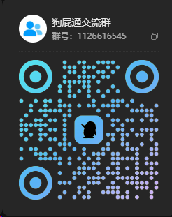

# SUB6

SUB6 is an independently maintained distribution of [Ranxi Sub2API](https://github.com/ranxi2001/sub2api). Current source candidate: **0.1.8**, based on formal Ranxi **v2.21.3** (`aa8e596e6d6f3e4648d6beba73b39b240dd5357a`). The prepared stable updater patch is [v0.1.7](https://github.com/zhang2580384/SUB6/releases/tag/v0.1.7); verify final publication in Releases. The candidate retains stable 0.1.5 WS isolation and all 0.1.6 usage filters, group colors and pool shutdown fixes. There are no new migrations since 0.1.6; the two migrations since stable 0.1.5 have a reviewed online plan after an operator installs protocol 2. This source candidate incorporates the stable updater repair but has no installable assets. See [stable fix synchronization](maintenance/2026-11-15-v0.1.8-stable-sync.md). See [review, exclusions and validation](maintenance/2026-11-15-upstream-review.md). Source publication does not deploy production.

Google OAuth application credentials are not embedded. Antigravity and Gemini CLI login/refresh require explicit client configuration; see `deploy/.env.example` and the maintenance report. Remote credential-service endpoints default to empty and must be configured independently.

[中文与完整构建命令](README.md) · [Upgrade compatibility](maintenance/2026-11-14-upstream-review.md) · [Deployment](deploy/README.md)

Requires Go 1.27.4, Node.js 22+, pnpm 9.15.9, PostgreSQL and Redis. Install frontend dependencies with `--frozen-lockfile --ignore-scripts`, build the frontend, then build `backend/cmd/server` with `-tags embed`. The optional direct-access sidecar implements cumulative-credit quotas, administrator credit inclusion and audited manual total overrides. It does not write main balances. The rolled-back custom image orchestrator is excluded; the upstream Codex image bridge remains off by default.

Only [SUB6 source and releases](https://github.com/zhang2580384/SUB6/releases) belong to this distribution. Version 0.1.7 provides source and an embedded-frontend Linux amd64 release binary with administrator update controls; no container image is published. See [build and runtime requirements](maintenance/BUILD-v0.1.6.md). Online updates require a compatible asset and mandatory checksums from this repository. CI never deploys production. Database migrations run at startup; read the maintenance report before upgrading and retain restorable backups.

Community QQ: **1126616545**.

Original LGPL-3.0 licensing, copyrights and upstream attribution are preserved. The linked BEpusdt engine is GPL-3.0; distributing the combined server must satisfy its corresponding-source and other GPL requirements. See [LICENSE](LICENSE) and [THIRD_PARTY_NOTICES.md](THIRD_PARTY_NOTICES.md).

Optional operator-installed rolling updater: [deploy/managed-updater](deploy/managed-updater/README.md). It coordinates both main and WS gateway containers; migration changes require operator review.

This version includes the stable 0.1.5 WebSocket isolation fix. See [stable/candidate synchronization](maintenance/2026-11-14-stable-candidate-sync.md).
