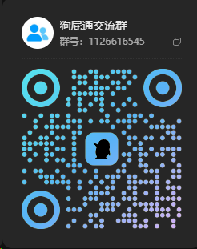

# SUB6

SUB6 は [Ranxi Sub2API](https://github.com/ranxi2001/sub2api) を基に独立して保守するオープンソース配布版です。独自バージョンは **0.1.2**。Ranxi v2.21.2 (`dbed7697aa56e76c6eb48c4914fa441496b67bdd`) を基に、production `ccf997c73868083d96c0bec56e71c1a34d26c98a` まで同期しています。

[ビルド手順・中文](README.md) · [移行と互換性](maintenance/2026-11-13-v0.1.2-review.md) · [配備](deploy/README.md)

Go 1.27.4、Node.js 22 以降、pnpm 9.15.9、PostgreSQL、Redis が必要です。依存関係は `--frozen-lockfile --ignore-scripts` で導入し、フロントエンドの後に `-tags embed` でバックエンドをビルドしてください。0.1.2 はソースとフロントエンドを内蔵した Linux amd64 バイナリを提供します。コンテナイメージは公開しません。[ビルドと実行条件](maintenance/BUILD-v0.1.2.md) を参照してください。既存の自動インストーラーは無効化しており、更新は SUB6 リポジトリの検証済み資産のみを受け付けます。

Grok の少量トークン監視修正と、累計入金・管理者加算・手動上限に対応した独立 IP 許可リストを保持します。撤回済みの独自画像オーケストレーションは含めません。本番環境は自動更新しません。起動時のデータベース移行前にバックアップと復元手順を確認してください。

QQ コミュニティ：**1126616545**。

元の LGPL-3.0、著作権表示、上流への帰属を保持します。組み込まれた BEpusdt は GPL-3.0 です。結合されたサーバーの配布には対応ソース提供などの GPL 条件も適用されます。[第三者ライセンス](THIRD_PARTY_NOTICES.md) を参照してください。
